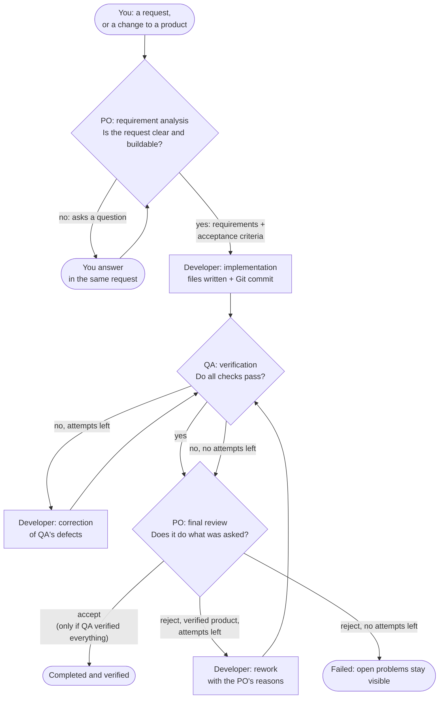

# AI Scrum Team Workspace

A local-first dashboard for **studying how a small Scrum team of AI agents
works**. You describe a product, and a Product Owner, a Developer and a QA
agent turn it into real files that are tested for real. Every step is
recorded: requirements, handoffs, files, commands, test results, defects,
corrections, Git commits and every AI request.

> **Status: experimental.** This is a personal research project, not a
> product. The team builds small products that run in the browser; the
> point is to observe and measure the team at work, not the quality of what
> it builds.

## Contents

- [Why this project exists](#why-this-project-exists)
- [Ground rules](#ground-rules)
- [The team](#the-team)
- [How a request flows](#how-a-request-flows)
- [What the dashboard shows](#what-the-dashboard-shows)
- [Getting started](#getting-started)
- [Turning on the AI (Claude Code)](#turning-on-the-ai-claude-code)
- [Running on an older Mac (virtual machine)](#running-on-an-older-mac-virtual-machine)
- [Configuration](#configuration)
- [Data, privacy and security](#data-privacy-and-security)
- [How it is built](#how-it-is-built)
- [Tests](#tests)
- [Limitations](#limitations)
- [How it was made](#how-it-was-made)
- [History](#history)
- [Disclaimer](#disclaimer)
- [License](#license)

## Why this project exists

I want to understand how a team of AI agents behaves when it works the way a
Scrum team does:

- how a Product Owner turns a vague request into requirements;
- how a Developer implements them;
- how QA verifies the result and sends defects back;
- how the team handles a change to something it already built.

To learn anything from that, **everything the dashboard shows has to be
real**. A nice-looking simulation would be useless, so the project follows a
few strict rules (below). The products are deliberately small, such as a
Hello World page, a coloured landing page or a simple browser game, so that a
whole cycle takes minutes and is easy to inspect.

The architecture is deliberately simple for the same reason. The goal is
the measurements (how the team works, how often it needs a human, where it
fails), not the product it delivers. Every extra layer of technology would
add noise to what is being observed.

## Ground rules

- **Only real events.** Every message, status and number in the dashboard
  comes from something that actually happened and was recorded. Nothing is
  invented: no fake conversations, no assumed test results, no sample data.
- **Honest labels.** Every agent and every message says whether it came
  from a **scripted** agent (fixed rules written in this repository) or an
  **AI-powered** one (a Claude model). Scripted behaviour is never presented
  as AI.
- **Independent verification.** QA always turns the acceptance criteria
  into deterministic tests and runs them with `node --test`, also when QA is
  AI-powered: no model can talk those checks round, so the model that wrote
  the code never grades its own work. An AI-powered QA can only **add**
  tests and defects. A result counts as verified only if QA actually ran the
  checks.
- **No guessing.** An AI-powered PO must ask before it decides. Anything it
  decides on your behalf is written down as such.
- **Exactly three agents: PO, Developer and QA.** The orchestrator that
  assigns work is infrastructure, not a team member. You, the human, are not
  an agent: you make the product decisions.
- **Local-first, no paid API.** Everything runs on your own computer. The AI
  agents use Claude Code with your existing Claude subscription. No API key
  and no pay-per-use billing.
- **Blocked, not faked.** When something is missing (an agent is disabled,
  the AI is unavailable, the usage limit is reached), the workflow stops as
  **Blocked** with the reason. You fix the cause and click **Resume**.

## The team

| Member | Kind | Responsibility |
|---|---|---|
| **You** | Human | Describe what to build, ask for changes, enable or disable agents, resume or cancel blocked work |
| **PO** (Product Owner) | Scripted or AI-powered | Refines your request by asking questions, then writes requirements, assumptions and machine-checkable acceptance criteria; applies change requests to the requirements; reviews the verified result |
| **Developer** | Scripted or AI-powered | Writes the product files; changes them for change requests; fixes defects reported by QA |
| **QA** (Quality Assurance) | Scripted or AI-powered | Generates one deterministic test per acceptance criterion, runs all tests, reports results and defects, and re-tests every correction. When AI-powered, it also writes tests of its own from your original request and flags requirements that may not match it |
| Orchestrator | Infrastructure | Assigns each stage to the responsible agent if it is enabled, executes the work, records every step |

### Scripted or AI-powered

You choose each agent's **Brain** on the Team page:

- **Scripted** (the default): rules and templates in `src/agents/` and
  `src/recipes/`, with no AI model. The scripted PO recognises one kind of
  request, a **Hello World web application**, and honestly answers "needs
  clarification" for anything else.
- **AI-powered** (any of the three): the agent's decisions come from a
  Claude model through Claude Code. The team can then build anything that
  **runs in a browser from static files** (HTML, CSS and JavaScript, with no
  server and no external resources): from a simple page to a small game.

**The AI-powered PO refines before it writes.** It looks for everything
your request leaves open (what exactly, scope, texts, look, behaviour and
rules, controls, start and end, edge cases) and stops to ask: several
numbered questions at once, each with why it matters and, where useful,
some options. "Build a game" always gets questions. This is enforced, not
just asked for: before you have answered anything, a PO answer that
decides a detail you never gave is refused and the PO has to ask instead.
When you answer "you decide", the PO may decide, and the requirements list
every **assumption** with who made it: *from you* or *decided by the PO*.

**The AI-powered QA adds its own tests.** The deterministic checks of the
PO's criteria always run first. Then QA writes extra tests from **your
original request and your answers**, not only from the PO's criteria, and
tells the PO when the requirements may not match what you asked. Its tests
run with **read-only access to the product folder** (Node's permission
model: no writing, no processes, no workers) and may only use a short list
of Node modules. A failing QA test is a defect for the Developer; a QA test
file that crashes is QA's own problem and never counts against the product.

When the PO is AI-powered, its **final acceptance** is an AI decision too:
the PO reads the request, the requirements, QA's results and the product
files, then accepts or rejects with its reasons. One guard stays fixed: the
PO **may reject** a product whose tests pass (for example when it does not
really do what you asked), but **cannot accept** one that QA did not
verify. The scripted PO accepts by rule: only if QA verified every
criterion.

## How a request flows



1. **Requirement analysis (PO).** The PO writes `REQUIREMENTS.md` with
   requirements and acceptance criteria. Each criterion has a check that QA
   can test automatically, such as "the page shows the text *hello world*"
   or "the background colour is green". If anything is open, unclear or
   cannot be built, the PO asks you instead of guessing. The request then waits for
   your answer: you reply in the same request box ("For" shows **Answer the
   PO's question**), and the PO continues **the same request**, seeing all
   its questions and all your answers. Only the latest request of a product
   can be left waiting, for example if you stop before answering.
2. **Implementation (Developer).** The product files are written to disk and
   committed to the product's own Git repository.
3. **Verification (QA).** QA generates `test/acceptance.test.mjs` from the
   criteria, runs every test, and reports a verdict with evidence. An
   AI-powered QA also runs its own tests (`qa/ai-checks.mjs`, read-only) and
   raises concerns for the PO.
4. **Correction (Developer).** If tests fail, QA sends the defects back to
   the Developer, and QA verifies the correction again.
5. **Final review (PO).** The PO accepts or rejects the product:
   - It **can never accept** a product that QA did not verify.
   - An AI-powered PO **can reject** a verified product when, reading the
     files, it does not really do what you asked. The product then goes
     back to the Developer with the PO's reasons, QA verifies the rework,
     and the PO reviews it again, remembering its earlier reasons.
6. **Limit.** The Developer has **three implementation attempts** in
   total: the first build plus any corrections (from QA) and reworks (from
   the PO). When they are used up, the workflow ends as **Failed**, and the
   open defects or the PO's reasons stay visible.

One workflow runs at a time. A blocked workflow keeps that slot until you
resume or cancel it.

### Who decides what

| Decision | Scripted mode | AI-powered mode | Safeguard |
|---|---|---|---|
| Is the request clear and buildable? | PO matches it against fixed recipes | PO (Claude), in rounds of questions | Before you answer anything, a PO that decides a detail you never gave is refused and must ask |
| Requirements and acceptance criteria | PO copies them from the recipe | PO (Claude) | Every criterion must use a check type QA can test automatically; every assumption says who decided it |
| The product files | Developer fills a template | Developer (Claude) | Files are checked before writing: inside the product folder, allowed types, not in `test/`, nothing loaded from the internet |
| Do the checks pass? | QA runs the deterministic tests | QA runs the same deterministic tests **plus** tests it writes from your request | Real `node --test` runs; the deterministic checks always run; QA's own tests run read-only and can only add defects |
| Accept or reject | PO by rule: accept only if QA verified everything | PO (Claude), with its reasons | Claude may reject a verified product, but an "accept" without QA verification is refused |

Every AI answer must match the agent's **contract** (a fixed JSON shape
with validated content). An answer that does not match is sent back once
with the problems listed; a second bad answer **blocks** the workflow with
the reason instead of being used. The workflow also blocks (never fails
silently) when an agent is disabled or Claude Code is unavailable. Fix the
cause and click **Resume** to continue from the same stage.

### New products and change requests

The dashboard opens with a clean workspace, ready for a new request (work
that is still running or blocked is shown instead). Below the request box,
**For** chooses what a request is for, and always matches what is on
screen:

- **A new product**: the team starts from scratch. Choosing it, or clicking
  **New request**, clears the workspace.
- **Change: *product name***: a **change request** to a product that
  already exists. The PO starts from the product's current requirements and
  writes the next version, listing what it added, changed or removed. The
  Developer changes the existing files. QA re-runs the checks for **every**
  criterion, old and new, so a change that breaks something is caught. All
  iterations of a product share one folder and one Git repository.
  Choosing a product in **For**, or opening one of its requests from
  **Projects**, shows its latest conversation and makes the next request a
  change to it.

Change requests need the PO and the Developer in AI-powered mode. The
scripted PO only recognises new Hello World requests, and says so.

## What the dashboard shows

| Page | What you find there |
|---|---|
| **Home** | The conversation between you and the team, built from recorded events; a stage tracker; the request box; and below it the latest **Team Activity** of the request on screen. Blocked workflows show **Resume** and **Cancel**. |
| **Projects** | Every product with its requests: the first one and each change request. Open a request, see the requirements, request a change, or delete the product. |
| **Requirements** | Every version of a product's requirements and acceptance criteria, with the changes each change request made. |
| **Team** | The three agents, with **Enabled/Disabled** (availability) and **Brain** (scripted or AI-powered); the AI provider settings with a real connection test. |
| **Team Activity** | Every recorded event with its evidence: files with checksums, commands with output and exit codes, test results, defects, commits, AI requests, and configuration changes. |
| **Repository** | The result: outcome, acceptance criteria with their status, test results, open issues, files read from disk, and Git commits. |
| **Analytics** | Statistics calculated from the recorded data, with a project filter and a date range, organised in sections: **Overview** (requests and outcomes), **How the team worked** (the PO, the Developer and QA side by side: interruptions and questions, each question counted, guesses stopped, details left to the PO, requirement gaps found later, QA concerns agreed with, work sent back, code defects, mistakes caught by QA, right first time, AI answers refused by each agent's rules), **Quality**, **Flow and blocks**, and collapsed **Details** with how every number is calculated. Every defect records its **origin** (requirements or implementation), and the PO answers each QA concern explicitly. |
| **Live Preview** (right column) | The generated page, served by a separate local preview server and shown in the dashboard. |

Details worth knowing:

- **Agent availability.** A disabled agent gets no new work. If it is
  needed, the workflow is blocked at that stage. Re-enable it and click
  **Resume**; earlier stages are not repeated. An agent disabled mid-task
  finishes that task first.
- **AI requests.** Every request to the model is recorded with model,
  purpose, duration, token counts and outcome. An answer that does not match
  the agent's contract is retried once, then the workflow blocks with the
  reason.
- **Live Preview** reports **Running** only after the page has actually been
  loaded from the preview server.
- **Analytics** labels each number **Recorded** (read directly from the
  records) or **Calculated** (derived from them), explains how it is
  computed, and shows "Not enough data yet" rather than a guess. **Export
  CSV** downloads, with the current filters, the statistics on the page, one
  row per request (status, verification, clarifications, corrections, tests,
  AI requests and tokens), or one row per agent task, for your own analysis
  in a spreadsheet.
- **Deleting** a product (on Projects or Repository) is permanent and needs
  your confirmation. It removes the product's requests, conversations,
  activity, statistics, files and Git history. **Delete all products** resets
  the workspace. A product whose request is running cannot be deleted.

## Getting started

### Requirements

- **Node.js 22 LTS, version 22.13 or newer**, but not 23 or later. Nothing
  else to install: no npm packages, no database server, no Docker.
- **Git** (recommended). Without it, products are still built, tested and
  saved, and the dashboard says that no commit was made.
- **Claude Code**, only for AI-powered agents (see below).

Developed and tested on macOS and Linux (Windows is untested). The server
uses little memory and listens on `127.0.0.1` only.

### Install and run

```bash
git clone https://github.com/ciroama/ai-scrum-team-workspace.git
cd ai-scrum-team-workspace
npm test     # the full test suite, including real end-to-end workflows
npm start    # then open http://localhost:3000
```

Keep the terminal open while you use the dashboard. Press `Ctrl + C` to
stop it.

To try it without any AI: leave all agents scripted and ask for
*"Build a simple Hello World web application"*.

On **macOS 11 (Big Sur)**, install Node.js 22 with the `.pkg` installer
from <https://nodejs.org/dist/latest-v22.x/>. Newer Node versions do not
support macOS 11. Claude Code does not run on macOS 11 either; see
[Running on an older Mac](#running-on-an-older-mac-virtual-machine).

## Turning on the AI (Claude Code)

The AI-powered agents use [Claude Code](https://code.claude.com/docs/en/overview),
logged in with **your own Claude subscription**, for example Claude Pro.

1. Install Claude Code on the computer that runs the workspace:
   `curl -fsSL https://claude.ai/install.sh | bash`. It needs macOS 13 or
   newer, Linux, or Windows.
2. Run `claude` once in a terminal and log in with your Claude account.
   Choose the subscription login, not an Anthropic Console (API) account.
3. In the dashboard open **Team** → **AI provider: Claude Code** → **Test
   connection**. It sends one small real request and shows the result.
4. On the PO and Developer cards, set **Brain** to **AI-powered (Claude
   Code)**.

How the integration behaves:

- **Text only.** Each AI request runs `claude -p` once, in an empty
  temporary folder, with **all tools disabled**. The model can only answer.
  The workspace checks the answer against the agent's contract and then
  writes the files itself. Files must stay inside the product folder, use
  allowed file types, keep out of QA's `test/` folder, and load nothing from
  the internet.
- **Subscription, not paid API.** `ANTHROPIC_API_KEY` and
  `ANTHROPIC_AUTH_TOKEN` are removed from Claude Code's environment, so a key
  set on your computer can never turn this into pay-per-use billing.
- **Usage limits.** Requests count against your subscription's usage limit.
  A workflow uses about 2–4 requests, and more when QA finds defects. The
  default model is `sonnet`, which uses less of the limit than `opus`; you
  can change it on the Team page. When the limit is reached, the workflow
  blocks with the reason; resume it later.
- **Failures are explicit.** If Claude Code is not installed, not logged in,
  over its limit, or gives no answer within 5 minutes, the workflow blocks
  and says why.

## Running on an older Mac (virtual machine)

Claude Code needs macOS 13 or newer. On an older Mac (this project was built
on an Intel MacBook Air with macOS 11 and 8 GB of RAM), run the workspace
in a small Linux virtual machine and use it from the Mac's browser.

1. Install [UTM](https://mac.getutm.app/). For macOS 11, use
   [UTM 4.7.5](https://github.com/utmapp/UTM/releases/tag/v4.7.5), the last
   version that supports it.
2. Create a VM with **Virtualize → Linux** and an **Ubuntu Server** (amd64)
   ISO: 4 GB of memory, 2 CPU cores, about 25 GB of disk. During
   installation, choose **Install OpenSSH server**. Before the first boot,
   remove the ISO from the VM's drives.
3. In the VM, install Node.js and Git, then Claude Code, and log in:

   ```bash
   sudo apt update && sudo apt install -y nodejs npm git   # check: node -v shows v22.13 or newer
   curl -fsSL https://claude.ai/install.sh | bash
   claude                                                  # log in once, then /exit
   ```

4. In the VM, clone this repository and run `npm test` and `npm start`.
5. On the Mac, open a terminal and connect with a tunnel for the dashboard
   and the Live Preview ports. Replace the user name and address with your
   VM's; `hostname -I` in the VM shows the address.

   ```bash
   ssh -L 3000:127.0.0.1:3000 -L 3001:127.0.0.1:3001 <user>@<vm-address>
   ```

6. Open <http://localhost:3000> on the Mac. Keep the SSH window open.

Inside the VM, the workspace still listens only on `127.0.0.1`; the tunnel is
the only way in.

## Configuration

Environment variables, for example `PORT=4000 npm start`:

| Variable | Default | Meaning |
|---|---|---|
| `PORT` | `3000` | Dashboard port |
| `PREVIEW_PORT` | `3001` | Live Preview port (`0` picks a free one) |
| `WORKSPACE_DATA_DIR` | `./data` | Where the database and the generated products are stored |
| `CLAUDE_BINARY` | `claude` | The Claude Code command, if it is not on the `PATH` as `claude` |

Everything else (agent availability, agent modes, the model) is set in the
dashboard and saved in the local database.

## Data, privacy and security

- **Everything stays on your computer** in `data/`, which Git ignores:
  - `data/workspace.db` (SQLite): products, workflows, tasks, events,
    settings;
  - `data/workflows/<product-id>/product/`: the generated files, with their
    own Git repository.
- **Product repositories are isolated.** Every Git command runs with
  explicit `--git-dir`/`--work-tree` paths, so it can never touch this
  dashboard's repository. Nothing is ever pushed anywhere.
- **No credentials are stored.** The Claude login belongs to Claude Code.
- **What leaves your computer:** only when the PO or the Developer is
  AI-powered. Then your request text, the requirements and the product files
  are sent to Anthropic through Claude Code.
- **Local only.** The dashboard and the preview server listen on
  `127.0.0.1`. There is no login, so do not expose them to a network.
- **Generated code runs locally.** QA runs the generated tests with Node.js
  on your computer, and the preview serves the generated page. The AI
  produces only static files (pages, styles, browser scripts), checked
  against the contract before they are written.
- **Deletion is real.** Deleting a product removes its records and its
  folder.

## How it is built

Plain Node.js (ES modules) and plain browser JavaScript. There is **no build
step and no dependencies**. It uses the built-in `node:sqlite` for storage,
`node --test` for tests, and Server-Sent Events for live updates.

```
src/
  main.js              entry point (checks the Node.js version)
  server/app.js        HTTP API, static files, live updates (SSE)
  core/                orchestrator (workflow state machine), stages, agent activity
  agents/              scripted PO, Developer, QA; team roster; ai/ AI-powered PO and Developer
  ai/                  Claude Code client, AI settings, contracts that validate model answers
  recipes/             request types the scripted agents know (Hello World)
  storage/             SQLite schema and repository
  actions/             file writing, command running, TAP parsing, isolated Git
  preview/             Live Preview server
  analytics/           statistics computed from recorded data
public/                dashboard (HTML, CSS, JavaScript modules)
test/                  node:test suites
docs/architecture.md   design details: state machine, events, contracts, API
```

The full design, including every event type, the agent contracts, the HTTP
API and the database schema, is in
[docs/architecture.md](docs/architecture.md).

## Tests

```bash
npm test
```

The suite runs real end-to-end workflows: real files, real `node --test`
runs and real Git commits in temporary folders. It also covers blocking and
resuming, the correction loop, change requests, deletion, Live Preview,
Analytics and the database migrations.

The AI paths run against a stand-in `claude` command that returns prepared
answers, so the tests need no account and use no quota. The real Claude Code
integration was checked by hand.

## Limitations

- The **scripted** agents know one request type: a Hello World web
  application.
- The **AI-powered** team builds products made of static files that run in
  the browser, such as pages and simple games: at most 8 files of up to
  200 KB each, with no server and no external resources.
- QA's checks are deterministic but simple: visible text, page title, files,
  CSS property values (colours compared after normalisation) and centred
  layout. QA does not use a browser, so it cannot judge visual quality or
  check behaviour, such as whether a game actually plays by its rules. That
  still needs a human.
- QA itself is not AI-powered, by design.
- One workflow at a time. An interrupted stage reruns from its start.
- The AI's output depends on the model. Answers that break the contract
  block the workflow instead of being used.
- No user accounts, and not meant for a shared network.

## How it was made

This project was built with [Claude](https://claude.ai) as my development
partner. Claude wrote the code, the tests and most of the documentation;
that is why most commits in the history list Claude as the author.

My role was on the product side: I conceived the idea, defined the vision
and the ground rules, wrote the requirements for each milestone, decided
what to build next and what to leave out, reviewed every result, and tested
the dashboard by hand, including the real Claude Code integration.

In other words, the project is a small experiment in the same idea it
studies: a human making the product decisions while AI does much of the
building.

## History

The project was built in milestones, all recorded in the Git history:

1. A dashboard with scripted agents and a real Hello World workflow.
2. A full workflow engine: enable and disable agents, block and resume, the
   correction loop, and a team workspace layout.
3. Live Preview and Analytics.
4. AI-powered PO and Developer. The first version used GitHub Models, which
   GitHub retired on 30 July 2026. It was replaced by Claude Code, using a
   Claude subscription.
5. Products with change requests, versioned requirements, and permanent
   deletion.

## Disclaimer

An independent personal project, not affiliated with or endorsed by
Anthropic or GitHub. Using Claude Code is subject to Anthropic's terms and
your subscription's usage limits.

## License

[MIT](LICENSE) © 2026 Ciro Amati. You may use, copy, modify and share the
code, as long as you keep the copyright and license notice. It comes with
no warranty.
